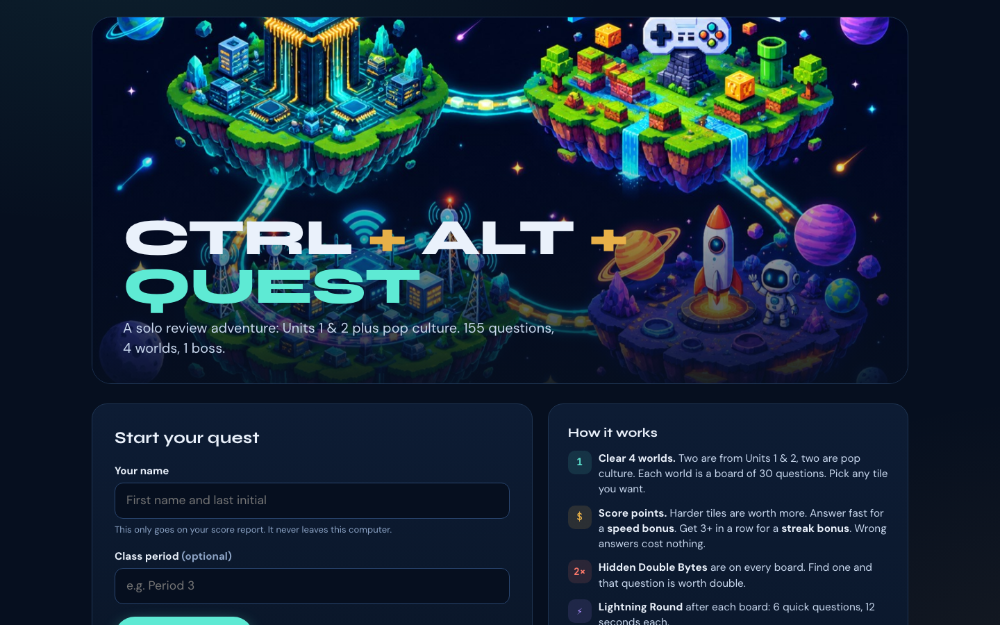

# CTRL + ALT + QUEST

**Live: https://regal-pebble-z8hx.here.now/**

A solo review adventure for 7th graders: 155 questions across 4 worlds and a boss stage. At the end, students download a PDF score report.

**What I built**
- Turned a teacher-led team game ([CTRL + ALT + COMPETE](https://github.com/Campgrnds/ctrl-alt-compete)) into a self-paced, auto-graded one
- Converted every short-answer question to multiple choice, with a build step (`build.py`) that refuses to ship if any conversion is missing
- Scoring with speed and streak bonuses, hidden Double Byte tiles, power-ups and a wager final
- A client-side PDF score report with a teacher check code, plus a verify page so teachers can confirm a report wasn't edited
- Progress saves in the browser so students can finish next class. No accounts, and nothing leaves the device

**Stack:** HTML, CSS, vanilla JavaScript, Python build script, AI-generated art (Higgsfield), static hosting on here.now

Single-player review game for 7th grade STEAM, built from the CTRL + ALT + COMPETE question banks
(Units 1–2 + Pop Culture edition). Students play solo and download a PDF score report at the end.

Live: https://regal-pebble-z8hx.here.now/
Teacher check page: https://regal-pebble-z8hx.here.now/verify.html

## Structure
- 4 worlds, played in order: BOOT UP (Unit 1) → PLAYER ONE (Pop R1) → GO ONLINE (Unit 2) → LEVEL UP (Pop R2).
  Each world has a 30-tile board followed by a 6-question Lightning Round (taken from the spares).
- Boss stage: Sudden Byte (all 10 tiebreakers), then Final Byte (one random final, with a wager).
- 155 questions per playthrough, about 40–50 minutes for a real student. Progress saves in the browser, so students can finish next class.
- Scoring: tile value + speed bonus (up to +50%) + streak bonus (from 3 in a row). Wrong answers cost 0.
  Hidden Double Byte tiles (1 per pop/unit-1 world, 2 in the 200–1000 worlds). Power-ups (one each per world): 50/50, Freeze, Shield.
- PDF report: score, rank, accuracy, time played, results by world and category, badges, a teacher check code, and a study list of missed questions.

## Editing questions
- `src/questions-units.json`, `src/questions-pop.json`: copies of the teacher banks.
- `src/mc-conversions.json`: multiple-choice versions of every short-answer item (the first choice is the correct one; the game shuffles them).
  If you add a short-answer question, add its choices here too, or `build.py` will stop and list what's missing.
- Run `./deploy.sh` to rebuild `site/bank.js` and republish to the same URL.

`site/bank.js` is XOR-scrambled so answers aren't readable with View Source. That only slows a curious student down; it isn't real security.
Art in `site/assets/` was generated with Higgsfield (gpt_image_2_5); the original PNGs are in `src/art-originals/`.

## Why the full question bank isn't here
This game is used with real students, so the full question bank stays out of the public repo,
which keeps the answer key off GitHub. `samples/` shows the schema of each bank file. The code, build pipeline and art are all here.

## License
Code: MIT (see `LICENSE`). Built by [Brandon Webster](https://campgrnds.com).
